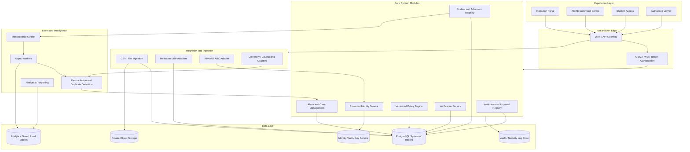

# System Architecture — APAAR-SHIELD

## 1. Architecture summary

APAAR-SHIELD uses a central regulatory registry for required student-level submissions, with event-driven lifecycle tracking and privacy-preserving identity controls. Institutions submit their admission records; external source adapters provide authorised verification/reconciliation; a versioned policy engine evaluates the record against the correct approval and academic year; dashboards expose scoped information and explainable cases.

**Recommended starting style:** domain-oriented modular monolith + asynchronous workers.  
**Long-term direction:** selectively extract identity, ingestion, event processing and analytics services when scale or security boundaries justify it.

## 2. Context and system boundary

### External actors and systems

- AICTE regulatory officers and policy administrators.
- AICTE-approved institutions and their ERP/SIS systems.
- Students.
- Affiliating universities and examination/enrolment systems.
- State/national counselling authorities.
- APAAR/ABC and authorised academic identity providers.
- DigiLocker/NAD issuer/requester ecosystem where applicable.
- Employers and other authorised verifiers.
- Hosting, identity, key-management and security operations providers.

### System responsibilities

APAAR-SHIELD is responsible for receiving, normalising, validating, linking, reconciling and reporting the student-level regulatory information submitted to it, subject to the source authority and legal permissions.

It is not authoritative for issuing APAAR IDs, creating AICTE approvals, determining university registration, awarding degrees or making final regulatory adjudications unless the competent authority formally delegates such a workflow.

## 3. Logical architecture

## 4. Domain modules and responsibilities

| Module | Owns | Must not own |
|---|---|---|
| IAM / access | Users, roles, memberships, permissions | Academic identity values |
| Institution registry | Institution, campus, university relationships | Student admissions |
| Approval registry | Programme approvals, EoA snapshots, intake | Policy interpretation outside versioned rules |
| Identity service | APAAR protection, verification lifecycle and matching token | Institution-submitted admission truth |
| Student registry | Internal student UUID and academic identity association | Admission lifecycle state |
| Admission service | Programme-specific admission instances and statuses | Official APAAR issuance |
| Ingestion service | Batch, staging, parsing, validation, idempotency | Silent overwrite of committed facts |
| Policy engine | Versioned rules, evaluation and evidence | Unreviewed policy decisions |
| Event service | Outbox, event schema and processing | Destructive editing of history |
| Reconciliation | Cross-source comparisons and candidate cases | Final fraud adjudication |
| Case management | Review, evidence, decision and escalation | Automatic final adverse decision based on ML |
| Verification service | Purpose-limited disclosures and signed responses | Public unrestricted lookup |
| Analytics | Aggregate read models and reports | Raw identity vault access by default |
| Audit | Append-only security/business audit evidence | User-editable history |

## 5. Trust boundaries

1. **Public internet to API edge:** WAF, rate limiting, TLS, request-size limits and attack monitoring.
2. **User to tenant boundary:** identity and role claims are validated server-side; the tenant/institution ID cannot be trusted from a client payload alone.
3. **Institution to platform:** every connector is authenticated and bound to an institution and source system.
4. **Platform to identity provider:** provider credentials are server-side; only approved operations and minimal fields are requested.
5. **General application to identity vault:** separate permissions, database credentials and KMS keys.
6. **Operational database to analytics:** only approved aggregate/limited datasets flow to analytics; raw APAAR is excluded.
7. **Platform to verifier:** purpose, scope, authorisation and expiry are checked before disclosure.
8. **Operator to production:** privileged access is time-bound, monitored and audited.

## 6. Synchronous and asynchronous operations

### Synchronous

- Login and session validation.
- Read institution/course/approval metadata.
- Validate a small individual admission request.
- Retrieve current case status.
- Create a batch job and return its ID.
- Authorise a verification request.

### Asynchronous

- Large CSV parsing and validation.
- Bulk identity verification.
- External provider retries.
- University/counselling reconciliation.
- Event consumption and read-model updates.
- Large report exports.
- Notification delivery.

Use queue retry with bounded exponential backoff, dead-letter handling, idempotent consumers and an operator replay process.

## 7. Data flow: student submission

1. Authenticated institution submits batch.
2. Upload enters private quarantine storage.
3. File scanner and schema validator run.
4. Rows load into staging tables with source provenance.
5. Data normalisation and institution/programme resolution run.
6. APAAR format and identity-verification processes are separated.
7. Exact duplicate and policy evaluations run.
8. Errors/warnings are returned for institution review.
9. Authorised representative certifies batch.
10. Committed admission records and outbox events are written in a database transaction.
11. Workers process events and reconciliation tasks.
12. Dashboards update from read models/aggregates.

## 8. Deployment topology

### Hackathon/local

- React web app.
- NestJS API container.
- PostgreSQL container.
- Redis container.
- BullMQ worker in API/worker process.
- Keycloak container or controlled demo OIDC configuration.
- Private local object storage emulator or protected filesystem volume.
- Mock provider fixtures.

### Pilot

- Separate dev, test, staging and production-like environments.
- Managed database with backups and point-in-time recovery.
- Private object storage with malware scanning.
- Managed secrets and key service.
- OIDC identity provider with MFA.
- Worker processes independently scaled from API.
- Central logs, metrics, traces and incident alerts.

### Production

Use a hosting environment approved by the system owner and applicable government policy/contract. Consider HA database, multi-zone deployment, controlled container orchestration, private networking, WAF/API gateway, KMS/HSM, SIEM, disaster recovery and independent security assessment. Do not assume a particular cloud provider or data-residency obligation without reviewing the applicable procurement, legal and CERT-In requirements.

## 9. Scalability and reliability

- Partition or archive high-volume event/audit tables based on measured growth.
- Use read replicas/read models for dashboard workloads when justified.
- Keep reporting queries away from latency-sensitive transaction paths.
- Use bulk inserts for ingestion but commit certified records with clear transaction boundaries.
- Paginate all list endpoints.
- Store files outside the relational database and retain secure file hashes/references.
- Add Kafka only when queue throughput, replay, multiple independent consumers or durable stream retention require it.
- Use outbox + idempotent consumers to avoid lost or duplicate events.
- Define RPO/RTO through a tested disaster recovery plan; initial targets are in `PLAN.md`.

## 10. Observability

Use OpenTelemetry traces and structured logs with correlation IDs. Useful metrics include:

- request rate, latency and 4xx/5xx rate;
- active batch jobs and queue age;
- row validation failure distribution;
- identity provider success, timeout and retry rates;
- rule evaluation counts by rule version;
- unresolved cases and case age;
- database connection saturation and query latency;
- authentication failures and privilege changes;
- audit pipeline health.

Never add raw APAAR, Aadhaar, OTP, passport or full request payloads to telemetry. Redact or tokenise values before they reach logs/traces.
