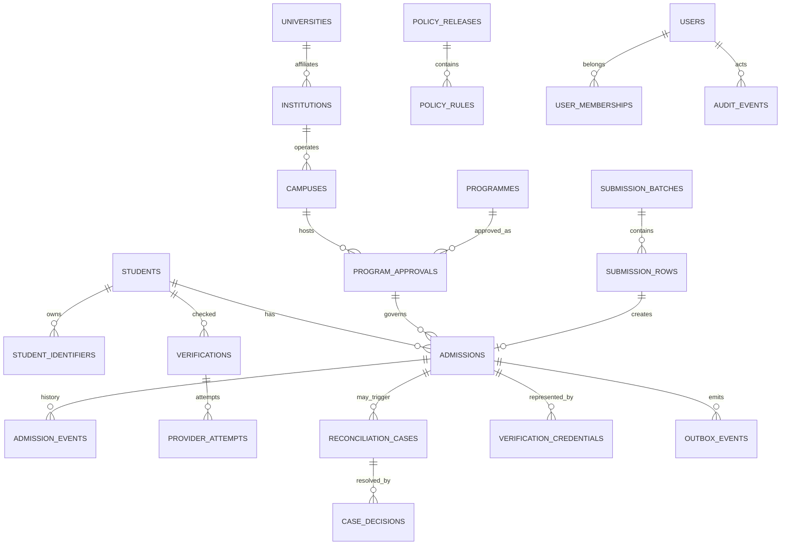

# Data Model & Database Design

## 1. Principles

- PostgreSQL is the transactional system of record for the MVP/pilot.
- Student identity, admission instances, programme approvals and lifecycle events are distinct concepts.
- Internal UUIDs are primary identifiers. Do not use APAAR as the database primary key.
- Every imported value has source provenance.
- Approval and policy versions are immutable once published.
- Student identity data is protected separately from routine admission data.
- Use append-only admission events and audit events.
- Derived counts are read models; they are not the only source of truth.

## 2. Logical entities

| Entity | Purpose | Key relations |
|---|---|---|
| `institutions` | Legal/AICTE institution master | has campuses, users, approval records |
| `campuses` | Approved campus/location | belongs to institution; hosts programmes |
| `universities` | Affiliating/degree-awarding authority master | linked to institutions and enrolment source |
| `programmes` | Standard programme/branch/level master | appears in approval records |
| `program_approvals` | Academic-year approval snapshot | campus + programme + approved intake + source |
| `policy_releases` | Published rule set | contains rules and release metadata |
| `policy_rules` | Individual category/capacity conditions | belongs to policy release |
| `students` | Internal student identity | has identifiers and admissions |
| `student_identifiers` | APAAR and other typed identifiers | belongs to student; source and verification metadata |
| `admissions` | A specific admission instance | student + approval + category + year + status |
| `admission_events` | Immutable lifecycle history | belongs to admission |
| `submission_batches` | Uploaded file/API submission | contains rows and processing state |
| `submission_rows` | Parsed row, validation and mapping outcome | may reference admission once committed |
| `verifications` | Identity/source verification request/result | belongs to student/identifier and provider |
| `provider_attempts` | Individual API/provider attempts | belongs to verification |
| `reconciliation_cases` | Potential conflict or mismatch | references admissions/source records |
| `case_decisions` | Reviewer decisions | belongs to case; actor and evidence |
| `processing_authorities` | Purpose, notice, consent or other legal-authority record | associated with processing context/subject |
| `users` | Local user shadow/profile | external OIDC subject reference |
| `user_memberships` | Institution/role binding | user + tenant + role |
| `audit_events` | Security and business audit | actor, action, entity, timestamp |
| `outbox_events` | Transactional event publication | event payload and processing state |
| `verification_credentials` | Signed/limited verification response | issuer, subject reference, scope, expiry/revocation |

## 3. ER diagram



## 4. Recommended SQL-level conventions

- `UUID` primary keys generated by the application or PostgreSQL.
- `TIMESTAMPTZ` for timestamps; store UTC internally and render local timezone in the UI.
- Store academic year consistently, e.g. `2026-27`, with a separately defined canonical parser.
- Use ISO country/nationality codes where required.
- Use enumerations or controlled reference tables for status/category values; avoid free-text codes in core calculations.
- Use `JSONB` only for provider-specific payload fragments, policy conditions and event metadata; keep frequently queried domain attributes as typed columns.
- Use migrations in every environment. Do not use ORM auto-sync in production.
- Apply foreign keys, check constraints, unique constraints and partial indexes where they express true domain invariants.

## 5. Key table definitions (logical SQL blueprint)

The following is a schema blueprint, not a ready-to-run migration. Review naming, data types, key-management integration and retention before production.

```sql
CREATE TABLE institutions (
  id UUID PRIMARY KEY,
  aicte_institution_ref TEXT NOT NULL UNIQUE,
  official_name TEXT NOT NULL,
  institution_type TEXT NOT NULL,
  status TEXT NOT NULL,
  source_ref TEXT,
  created_at TIMESTAMPTZ NOT NULL DEFAULT now(),
  updated_at TIMESTAMPTZ NOT NULL DEFAULT now()
);

CREATE TABLE campuses (
  id UUID PRIMARY KEY,
  institution_id UUID NOT NULL REFERENCES institutions(id),
  source_campus_ref TEXT,
  campus_name TEXT NOT NULL,
  address_json JSONB,
  status TEXT NOT NULL,
  UNIQUE (institution_id, source_campus_ref)
);

CREATE TABLE universities (
  id UUID PRIMARY KEY,
  source_ref TEXT UNIQUE,
  official_name TEXT NOT NULL,
  status TEXT NOT NULL
);

CREATE TABLE programmes (
  id UUID PRIMARY KEY,
  programme_code TEXT NOT NULL UNIQUE,
  programme_name TEXT NOT NULL,
  programme_level TEXT NOT NULL,
  discipline_code TEXT,
  status TEXT NOT NULL
);

CREATE TABLE policy_releases (
  id UUID PRIMARY KEY,
  authority TEXT NOT NULL,
  policy_name TEXT NOT NULL,
  policy_version TEXT NOT NULL,
  source_document_uri TEXT NOT NULL,
  source_document_hash TEXT,
  applicable_from_year TEXT NOT NULL,
  applicable_to_year TEXT,
  effective_from DATE,
  effective_to DATE,
  status TEXT NOT NULL, -- DRAFT / REVIEWED / PUBLISHED / RETIRED
  reviewed_by UUID,
  published_at TIMESTAMPTZ,
  UNIQUE (authority, policy_name, policy_version)
);

CREATE TABLE program_approvals (
  id UUID PRIMARY KEY,
  campus_id UUID NOT NULL REFERENCES campuses(id),
  programme_id UUID NOT NULL REFERENCES programmes(id),
  academic_year TEXT NOT NULL,
  approved_intake INTEGER NOT NULL CHECK (approved_intake >= 0),
  approval_reference TEXT NOT NULL,
  approval_status TEXT NOT NULL,
  source_document_uri TEXT NOT NULL,
  source_document_hash TEXT,
  policy_release_id UUID REFERENCES policy_releases(id),
  valid_from DATE,
  valid_to DATE,
  supersedes_approval_id UUID REFERENCES program_approvals(id),
  created_at TIMESTAMPTZ NOT NULL DEFAULT now()
);

CREATE TABLE policy_rules (
  id UUID PRIMARY KEY,
  policy_release_id UUID NOT NULL REFERENCES policy_releases(id),
  rule_code TEXT NOT NULL,
  category_code TEXT NOT NULL,
  counting_basis TEXT NOT NULL,
  limit_type TEXT NOT NULL,
  numerator INTEGER,
  denominator INTEGER,
  fixed_limit INTEGER,
  rounding_method TEXT,
  applicability JSONB NOT NULL DEFAULT '{}',
  eligibility_conditions JSONB NOT NULL DEFAULT '{}',
  source_clause TEXT NOT NULL,
  human_review_required BOOLEAN NOT NULL DEFAULT false,
  UNIQUE (policy_release_id, rule_code)
);

CREATE TABLE students (
  id UUID PRIMARY KEY,
  display_name TEXT,
  identity_status TEXT NOT NULL DEFAULT 'UNVERIFIED',
  created_at TIMESTAMPTZ NOT NULL DEFAULT now(),
  updated_at TIMESTAMPTZ NOT NULL DEFAULT now()
);

CREATE TABLE student_identifiers (
  id UUID PRIMARY KEY,
  student_id UUID NOT NULL REFERENCES students(id),
  identifier_type TEXT NOT NULL, -- APAAR / INSTITUTION_ID / UNIVERSITY_ID / OTHER
  protected_ciphertext BYTEA,
  match_token BYTEA,
  key_version TEXT,
  source_system TEXT NOT NULL,
  source_reference TEXT,
  verification_status TEXT NOT NULL,
  valid_from DATE,
  valid_to DATE,
  created_at TIMESTAMPTZ NOT NULL DEFAULT now()
);

CREATE TABLE admissions (
  id UUID PRIMARY KEY,
  student_id UUID NOT NULL REFERENCES students(id),
  approval_id UUID NOT NULL REFERENCES program_approvals(id),
  source_system TEXT NOT NULL,
  external_record_id TEXT,
  admission_date DATE,
  admission_route TEXT NOT NULL,
  entry_type TEXT NOT NULL, -- FIRST_YEAR / LATERAL_ENTRY / OTHER_APPROVED
  seat_category TEXT NOT NULL,
  nationality_code TEXT,
  oci_status TEXT,
  admission_status TEXT NOT NULL,
  university_reference_protected BYTEA,
  source_submission_row_id UUID,
  created_at TIMESTAMPTZ NOT NULL DEFAULT now(),
  updated_at TIMESTAMPTZ NOT NULL DEFAULT now()
);

CREATE UNIQUE INDEX uq_admission_source_record
  ON admissions (approval_id, source_system, external_record_id)
  WHERE external_record_id IS NOT NULL;

CREATE TABLE admission_events (
  id UUID PRIMARY KEY,
  admission_id UUID NOT NULL REFERENCES admissions(id),
  event_type TEXT NOT NULL,
  previous_status TEXT,
  new_status TEXT,
  source_system TEXT NOT NULL,
  source_event_id TEXT,
  actor_user_id UUID,
  occurred_at TIMESTAMPTZ NOT NULL,
  received_at TIMESTAMPTZ NOT NULL DEFAULT now(),
  schema_version TEXT NOT NULL,
  payload JSONB NOT NULL DEFAULT '{}',
  UNIQUE (source_system, source_event_id)
);

CREATE TABLE submission_batches (
  id UUID PRIMARY KEY,
  institution_id UUID NOT NULL REFERENCES institutions(id),
  source_system TEXT NOT NULL,
  academic_year TEXT NOT NULL,
  content_hash TEXT,
  idempotency_key TEXT NOT NULL,
  status TEXT NOT NULL,
  total_rows INTEGER,
  created_by UUID NOT NULL,
  submitted_at TIMESTAMPTZ NOT NULL DEFAULT now(),
  UNIQUE (institution_id, idempotency_key)
);

CREATE TABLE submission_rows (
  id UUID PRIMARY KEY,
  batch_id UUID NOT NULL REFERENCES submission_batches(id),
  row_number INTEGER NOT NULL,
  source_record_id TEXT,
  status TEXT NOT NULL,
  error_codes TEXT[] NOT NULL DEFAULT '{}',
  warning_codes TEXT[] NOT NULL DEFAULT '{}',
  source_payload JSONB NOT NULL,
  admission_id UUID REFERENCES admissions(id),
  UNIQUE (batch_id, row_number)
);

CREATE TABLE verifications (
  id UUID PRIMARY KEY,
  student_id UUID NOT NULL REFERENCES students(id),
  identifier_id UUID REFERENCES student_identifiers(id),
  provider_code TEXT NOT NULL,
  mode TEXT NOT NULL, -- MOCK / SANDBOX / PRODUCTION
  purpose_code TEXT NOT NULL,
  status TEXT NOT NULL,
  provider_reference TEXT,
  requested_at TIMESTAMPTZ NOT NULL DEFAULT now(),
  completed_at TIMESTAMPTZ,
  response_metadata JSONB NOT NULL DEFAULT '{}'
);

CREATE TABLE reconciliation_cases (
  id UUID PRIMARY KEY,
  case_type TEXT NOT NULL,
  severity TEXT NOT NULL,
  status TEXT NOT NULL,
  rule_code TEXT,
  policy_release_id UUID REFERENCES policy_releases(id),
  explanation TEXT NOT NULL,
  evidence_refs JSONB NOT NULL DEFAULT '[]',
  assigned_to UUID,
  created_at TIMESTAMPTZ NOT NULL DEFAULT now(),
  resolved_at TIMESTAMPTZ
);

CREATE TABLE case_decisions (
  id UUID PRIMARY KEY,
  case_id UUID NOT NULL REFERENCES reconciliation_cases(id),
  reviewer_id UUID NOT NULL,
  decision_code TEXT NOT NULL,
  reason TEXT NOT NULL,
  evidence_reference TEXT,
  decided_at TIMESTAMPTZ NOT NULL DEFAULT now()
);

CREATE TABLE audit_events (
  id UUID PRIMARY KEY,
  actor_id UUID,
  institution_id UUID REFERENCES institutions(id),
  action TEXT NOT NULL,
  entity_type TEXT NOT NULL,
  entity_id UUID,
  request_id TEXT,
  outcome TEXT NOT NULL,
  occurred_at TIMESTAMPTZ NOT NULL DEFAULT now(),
  metadata JSONB NOT NULL DEFAULT '{}'
);

CREATE TABLE outbox_events (
  id UUID PRIMARY KEY,
  aggregate_type TEXT NOT NULL,
  aggregate_id UUID NOT NULL,
  event_type TEXT NOT NULL,
  schema_version TEXT NOT NULL,
  payload JSONB NOT NULL,
  created_at TIMESTAMPTZ NOT NULL DEFAULT now(),
  published_at TIMESTAMPTZ,
  attempts INTEGER NOT NULL DEFAULT 0
);
```

## 6. Identity vault design

Do not store a searchable plaintext APAAR value in the general admissions database.

Recommended pattern, subject to legal approval and provider requirements:

1. Receive identifier only over an authenticated, encrypted channel.
2. Validate structure without claiming official identity.
3. Normalise only according to the identifier's official format.
4. Send to a dedicated identity service.
5. If retention is necessary and lawful, encrypt using envelope encryption backed by KMS/HSM.
6. Derive a deterministic keyed HMAC token using a protected key for internal matching.
7. Store key version and provenance.
8. Return an internal opaque student reference to the domain service.
9. Redact raw value from logs, traces, errors and analytics.
10. Apply retention/deletion/rotation procedures.

A plain hash of a low-entropy identifier can be brute-forced; use a keyed HMAC and protect the key outside the database. Avoid sharing one global match token with external institutions unless a formally approved protocol requires it.

## 7. Constraints and indexing guidance

- Unique institution source ID.
- Unique source admission key within source-system/approval scope.
- Unique batch idempotency key within institution.
- Unique external source event ID within source system.
- Index admissions by approval, student, status and admission date.
- Index events by admission and occurred time.
- Index unresolved cases by status/severity/created time.
- Use partial indexes only for actual domain invariants, not assumptions.
- Do not enforce one student per academic year across all programmes.
- Consider row-level security as defence-in-depth, but retain service-level tenant checks and tests.

## 8. Data retention and corrections

Retention periods must be set by the system owner, applicable law, records schedules, approval requirements and contracts. Do not invent a universal retention period for academic records.

For corrections:

- preserve the source submission;
- append a correction event;
- store actor, time, reason and evidence;
- update current projection transactionally;
- recalculate affected rule evaluations;
- record whether historic reports are restated or remain as-of snapshots.

## 9. Data quality statuses

Recommended statuses include:

- `RECEIVED`
- `STAGED`
- `FORMAT_VALID`
- `PENDING_VERIFICATION`
- `OFFICIAL_VERIFIED`
- `MOCK_VERIFIED`
- `MISMATCH`
- `PROVIDER_UNAVAILABLE`
- `REVIEW_REQUIRED`
- `CERTIFIED`
- `COMMITTED`
- `REJECTED`
- `WITHDRAWN`
- `CANCELLED`

Keep identity status, batch status, admission status and case status in separate fields; do not overload one status column.
