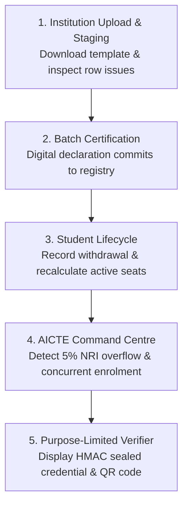

# APAAR-SHIELD

**National Academic Identity, Student Enrolment Integrity & Regulatory Intelligence Platform**  
**SIH Problem Statement:** SIH26263 — Development of an APAAR ID-Based Student Data Management and Verification Platform for AICTE-Approved Institutions  
**Sponsoring Organisation:** AICTE · Regulation Bureau  
**Status:** Interactive Prototype & Proposed Production Specification  

---

## ⚡ Quick Start: How to Run

### Option 1: Instant 1-Click Launch (Zero Setup / Works in Any Browser)

You do **not** need to install dependencies, run Docker, or start background services. The complete interactive showcase is pre-bundled in a single file with an embedded virtual regulatory and privacy engine.

Simply open the file in your preferred browser:

```powershell
# In Windows PowerShell:
Start-Process "f:\SIH 2026\APAAR-SHIELD\index.html"
```

*Or navigate to `f:\SIH 2026\APAAR-SHIELD` in File Explorer and double-click `index.html`.*

---

### Option 2: Local Static Web Server

If you prefer serving over `http://localhost`:

```bash
# Using Python (pre-installed):
cd "f:\SIH 2026\APAAR-SHIELD"
python -m http.server 3000

# Open http://localhost:3000 in your browser
```

---

### Option 3: Full Monorepo Development Environment

For contributors working on the backend APIs and frontend React build:

```bash
cd "f:\SIH 2026\APAAR-SHIELD"

# Run tests on the deterministic policy engine (Node 24 native test runner)
npm run test:policy

# Run identity vault cryptographic tests (AES-256-GCM & HMAC-SHA256)
npm run test:identity
```

---

## 🎯 8-Minute SIH Judge Demonstration Guide

Follow this step-by-step storyline to demonstrate the five core capabilities of APAAR-SHIELD:



### Step 1: Institutional Data Submission & Schema Validation
1. In the top switcher bar, select **Alpha Institute of Technology (PID: 1-3324567891)**.
2. Click **Download Approved CSV Template (.CSV)** to showcase standard schema readiness.
3. Click **Process Staged Admission File** to simulate parsing a live batch:
   - Notice the status badge: `VALIDATED_WITH_ISSUES`.
   - In the staging table, click **Inspect Diagnostic Details** on Row #3 (`INVALID_APAAR_FORMAT`) and Row #4 (`BATCH_DUPLICATE_ROW`).
   - Highlight the diagnostic modal providing exact failure codes, affected columns, and recommended regulatory fixes.

### Step 2: Head of Institution Certification
1. Click **Certify & Submit Valid Batch (Digital Declaration)**.
2. An official Council Order & Acknowledgement modal will display the transaction receipt and sync with the National Academic Vault.
3. Explain that only valid and reviewed rows commit transactionally into the national student registry.

### Step 3: Admission Lifecycle & Immutable History (Invariant 11)
1. Switch to the **Admissions Ledger** tab.
2. Click **Record Withdrawal** next to any student.
3. Enter an official reason (e.g., *"Accepted central counselling seat allotment at National Institute of Technology (NIT) under CSAB round"*).
4. Click **Confirm & Commit Withdrawal**.
5. Show how the status changes to `WITHDRAWN` while the historical record remains intact in the audit trail without erasing evidence.

### Step 4: AICTE Command Centre & Regulatory Intelligence
1. In the top bar, switch to **AICTE Regulatory Officer (HQ New Delhi)**.
2. Under **Intake Capacity Matrix**:
   - Highlight the **B.Tech CSE** row showing an alert condition.
   - Point out that **7 NRI students** were admitted, exceeding the 5% within-intake cap sanctioned in the AICTE Approval Process Handbook (limit is 6).
   - Point out the 15% supernumerary ceiling and the 1/3 reservation for wards of Indian workers in Gulf countries.
3. Switch to the **Reconciliation Cases** tab:
   - Highlight the flagged case: *Aryan Sharma* concurrently enrolled in both Alpha Institute and Beta College.
   - Click **Open Adjudication Scrutiny Bench** to open the side-by-side comparison.
   - Reference the **UGC Guidelines for Pursuing Two Academic Programmes Simultaneously (April 2022)**.
   - Click **Mark False Positive (Permitted Concurrency)** or **Request Institution Clarification** to adjudicate the case with human reasoning.
   - Notice the formal Council Adjudication Order receipt issued with dispatch reference, timestamp, and statutory citation.
4. Switch to the **Immutable Audit Ledger** tab to show that all regulatory decisions are logged in an unalterable log trail.

### Step 5: Authorised Verifier Portal (Privacy by Design)
1. Switch to **Third-Party Verifier (TCS Background Screening)**.
2. Select purpose code `EMPLOYMENT_BACKGROUND_CHECK` and click **Execute Authorised Verification Check**.
3. Showcase the official cryptographic disclosure certificate:
   - **Watermark:** AICTE Regulation Bureau authenticity stamp.
   - **Subject Reference:** `STU-0042` with candidate legal name (`Aarav Sharma`).
   - **Integrity Seal:** Cryptographic `HMAC-SHA256` signature.
   - **Instant Verification QR Code.**
   - Point out that personal attributes (Aadhaar, phone, DOB) are strictly omitted in compliance with India's DPDP Act minimisation requirements.

---

## 🏛️ Regulatory Foundations & Domain Invariants

APAAR-SHIELD implements strict domain rules defined in AICTE and Government of India regulations:

1. **Approved Intake is Programme, Campus & Year Specific:** Multi-year active populations are never compared against a single year's first-year intake.
2. **No Arbitrary Universal Formulas:** Category limits strictly follow the AICTE Approval Process Handbook (APH 2024–27). NRI is within intake ($\le 5\%$), FN/OCI/Gulf is supernumerary ($\le 15\%$), and Lateral Entry is an isolated 2nd-year cohort.
3. **Identity Is Not Admission:** One internal student identity can hold multiple legitimate academic events over time.
4. **Duplicate != Fraud:** Concurrent enrolments trigger contextual human review cases under UGC guidelines, not automated punitive actions.
5. **Privacy by Default:** Raw 12-digit APAAR numbers are isolated in a dedicated cryptographic vault (AES-256-GCM envelope encryption and versioned HMAC-SHA256 match tokens). Raw identifiers are never exposed in URLs, logs, or analytics.

---

## 📁 Repository Map

| Path | Purpose |
|---|---|
| [`index.html`](index.html) | **Zero-setup interactive prototype & demonstration platform** |
| [`packages/contracts/`](packages/contracts/) | Canonical TypeScript DTOs, Enums, and event interfaces |
| [`packages/policy-fixtures/`](packages/policy-fixtures/) | Versioned AICTE APH 2024–27 deterministic rule engine & tests |
| [`apps/api/`](apps/api/) | NestJS modular monolith backend with identity vault & controllers |
| [`apps/web/`](apps/web/) | React + TypeScript + Vite frontend application |
| [`database/schema.sql`](database/schema.sql) | Complete PostgreSQL schema matching `DATA_MODEL.md` |
| [`walkthrough.md`](file:///C:/Users/Aniket/.gemini/antigravity/brain/4a706846-2197-4d5c-a0f8-e142a005a089/walkthrough.md) | Comprehensive presentation walkthrough and validation report |

### Specification Documents

| File | Purpose |
|---|---|
| [`agent.md`](agent.md) | Coding agent guidelines and mandatory domain invariants |
| [`ARCHITECTURE.md`](ARCHITECTURE.md) | Logical & physical architecture and trust boundaries |
| [`DOMAIN_AND_REGULATORY.md`](DOMAIN_AND_REGULATORY.md) | Indian higher education domain, seat rules, and legal context |
| [`DATA_MODEL.md`](DATA_MODEL.md) | Entities, relationships, and PostgreSQL DDL blueprint |
| [`API_SPEC.md`](API_SPEC.md) | REST API endpoints, DTO contracts, and error structures |
| [`SECURITY_PRIVACY.md`](SECURITY_PRIVACY.md) | Threat model, identity vault, and DPDP / CERT-In compliance |
| [`TESTING_AND_DEMO.md`](TESTING_AND_DEMO.md) | Synthetic test datasets, scenarios, and demo requirements |
| [`SOURCES.md`](SOURCES.md) | Primary source links (AICTE APH, Gazette, UGC, API Setu) |
| [`DECISIONS.md`](DECISIONS.md) | Architecture Decision Records (ADRs) |
